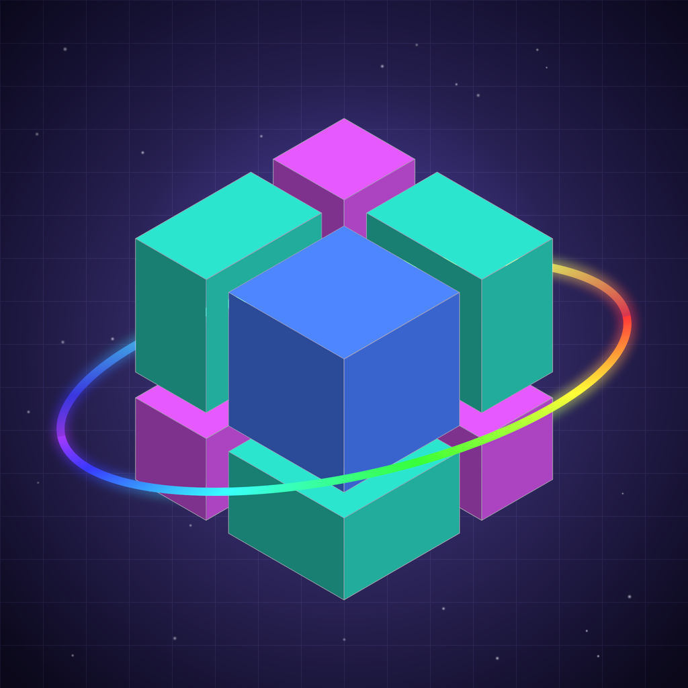
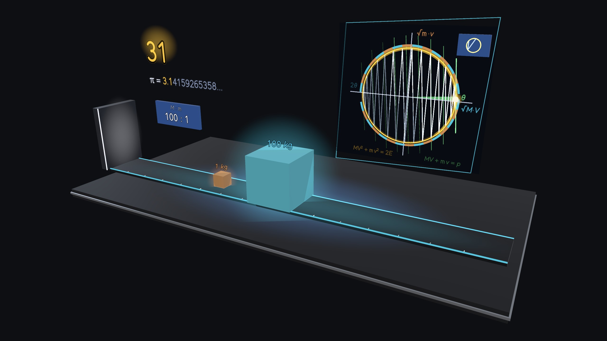
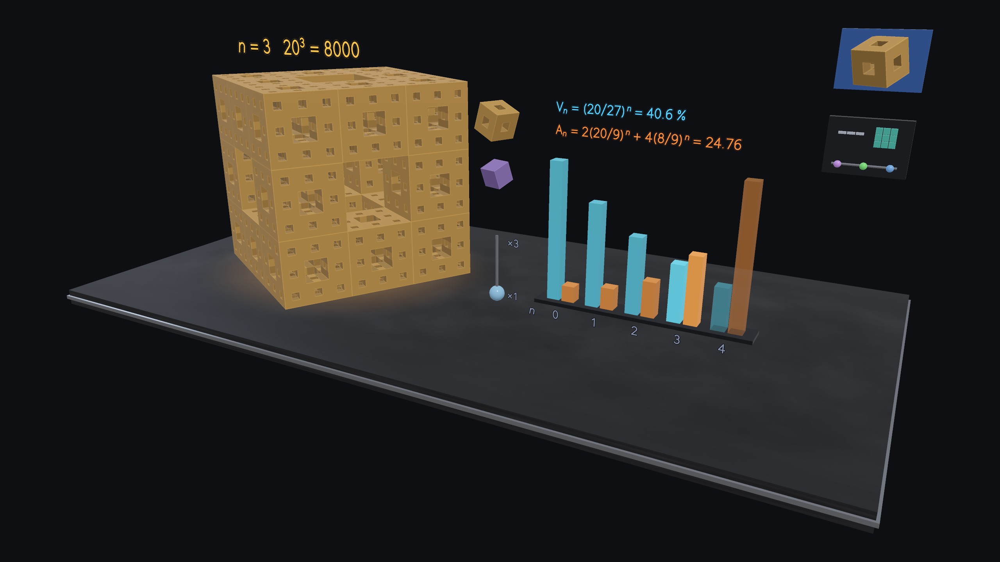
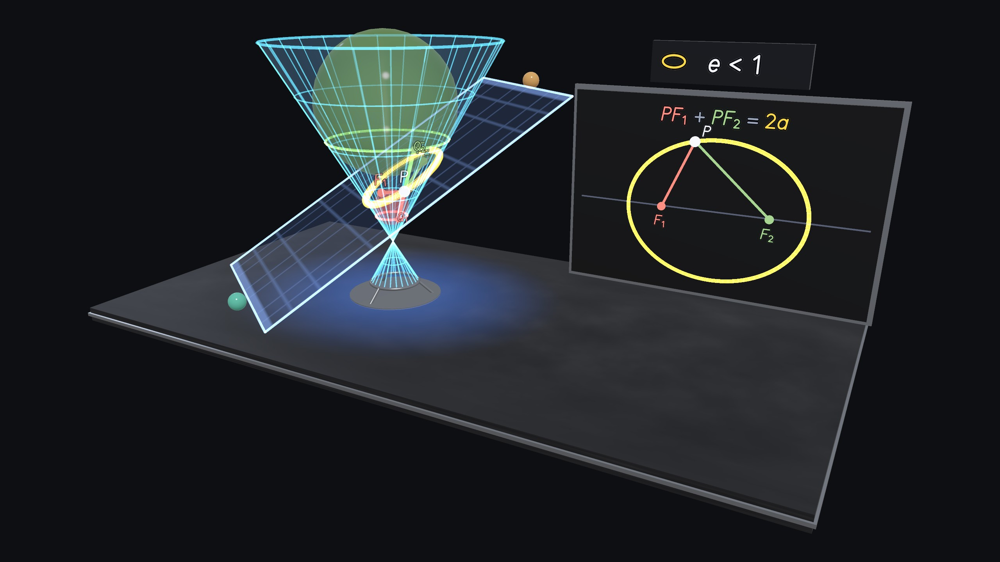
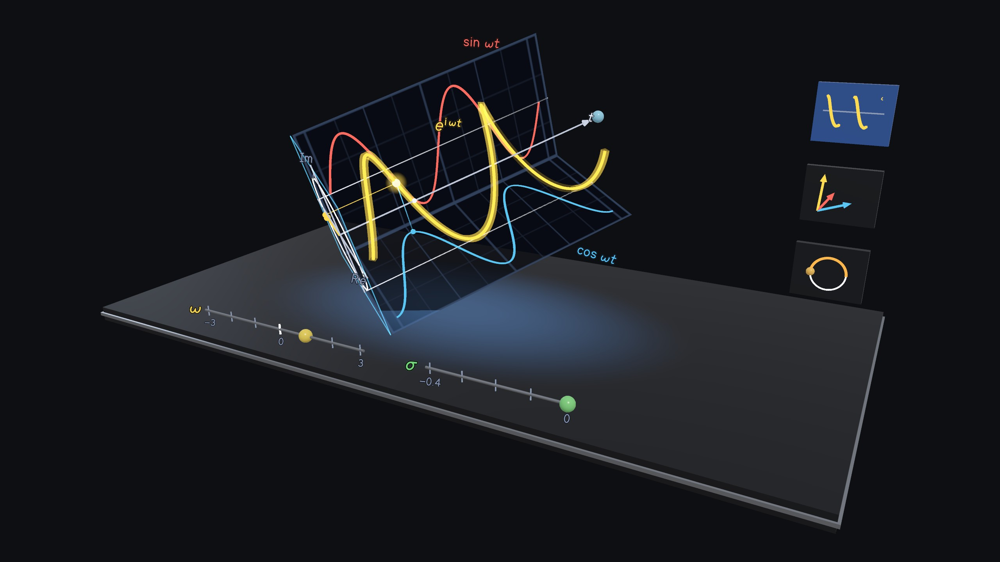
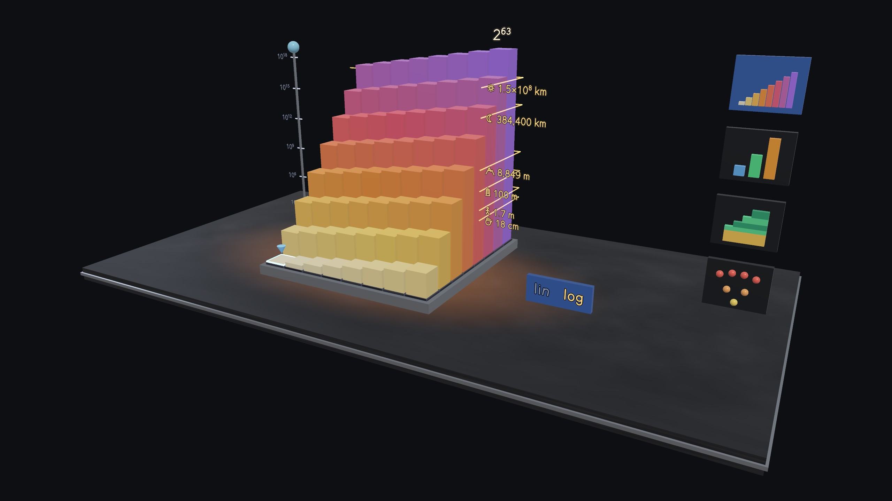
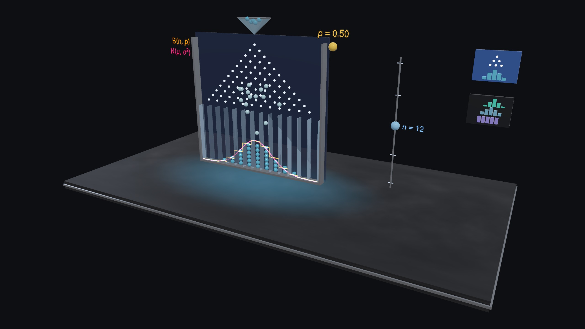
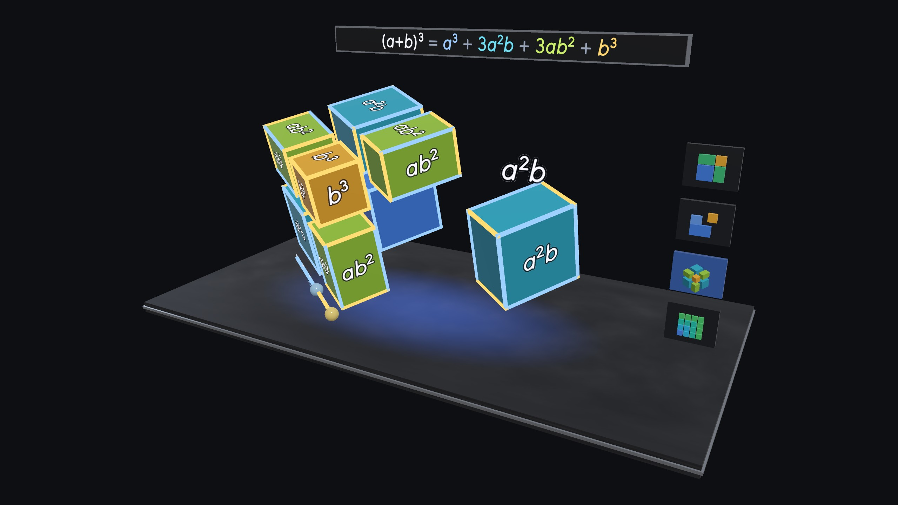
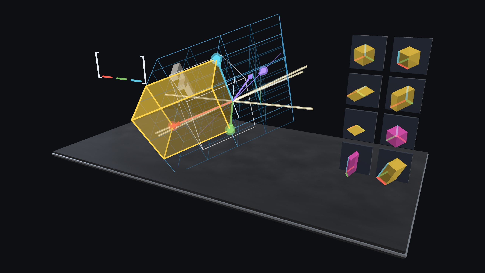
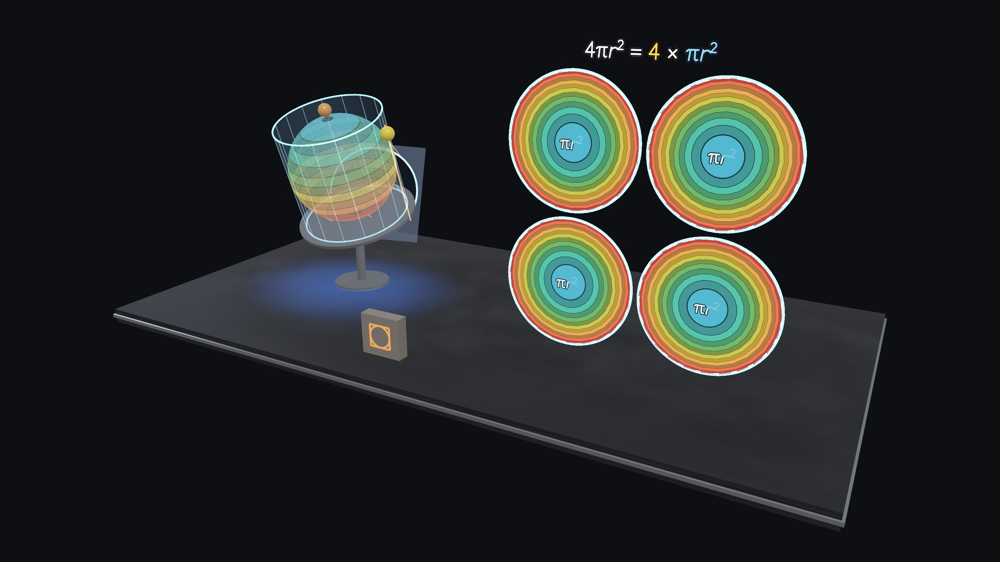

# 数学实验室 Spatial · Math Lab Spatial



9 个数学的「为什么」，做成可以拿在手里、绕着走的 3D 实物，运行在 PICO 头显（Swan）的 Shared Space 中。

灵感来自 3Blue1Brown：不背公式，而是看见它为什么成立。基于 PICO SpatialSDK（Kotlin + Compose）开发；中英双语界面。

姊妹作品：物理 / 化学 / AI 算法实验室 Spatial。

*9 mathematical "whys" as 3-D objects you can hold and walk around on PICO (Swan) Shared Space — in the spirit of 3Blue1Brown: don't memorise the formula, see why it is true. Built with PICO SpatialSDK (Kotlin + Compose). Chinese / English UI.*

| | |
|---|---|
|  |  |
|  |  |
|  |  |
|  |  |
|  | |

*截图为 2560×1440 无头渲染（`ShowcaseRenderTest`），与头显内的场景同源。HD stills rendered headlessly from the same scene code that runs on the headset.*

## 实验 · Experiments

| 实验 | Experiment | 你可以做什么 · What you do |
|---|---|---|
| **代数 · Algebra** | | |
| 代数的几何 · 乘法即面积（Euclid） | Algebra as Geometry | 拖动 a、b；剪拼证明 (a+b)²、(a+b)(a−b)；(a+b)³ 拆成 8 块 · Drag a, b; cut-and-move proofs; the exploded cube |
| 指数增长（棋盘上的米） | Exponential Growth | 真实比例的棋盘米柱、对数轴、n vs n² vs 2ⁿ、复利逼近 e · True-scale rice columns, log axis, the race, compounding → e |
| 线性变换与行列式（Cayley 1858） | Linear Transformations | 拖动基向量，整个 3D 网格跟着变；体积 = 行列式；特征向量 · Drag the basis; volume = determinant; eigenvectors |
| **几何 · Geometry** | | |
| 圆锥曲线 · Dandelin 球（Apollonius） | Conic Sections | 倾斜切面得到四种曲线；两个球的切点正是焦点 · Tilt the plane; the spheres touch at the foci |
| 球面积 · 阿基米德 | Sphere Area · Archimedes | 球带投影到圆柱面积不变；展开成 2πr×2r；正好四个影子 · Bands keep their area; four shadows |
| 分形 · 门格海绵（Menger 1926） | Fractals · Menger Sponge | 一层层挖空：体积 → 0、表面积 → ∞、维数 log20/log3 · Volume → 0, area → ∞, D ≈ 2.727 |
| **分析与概率 · Calculus & Probability** | | |
| 欧拉公式 · 复数即旋转（Euler 1748） | Euler's Formula | e^{iωt} 螺旋的两个影子是 cos 与 sin；乘法 = 旋转 + 缩放；e^{iπ} = −1 · The helix and its shadows |
| 高尔顿板 · 中心极限定理（Galton 1889） | Galton Board · CLT | 小球落成钟形；30 个歪骰子之和照样趋于正态 · Balls pile into a bell; sums of skewed dice too |
| 碰撞数出 π（Galperin 2003） | Colliding Blocks Compute π | 质量比 100ⁿ → 碰撞 3、31、314、3141…次；相空间里的等弧 · Collision counts spell π |

每个实验都带 **导学**：先预测、再动手、看结果、听解释，最后一个小挑战。
*Every experiment has a guided track — predict, do, observe, explain — and a challenge.*

## 数学是精确的 · The maths is exact

数学核心是纯 Kotlin（`app/src/main/java/.../core/`），测试检查的是真实结论：
- 精确恒等式与剪拼的面积 / 体积守恒；
- 2⁶⁴ − 1 精确到最后一位；
- 圆锥截线的焦点 = Dandelin 切点（误差 1e-13）；
- 碰撞次数 3、31、314、3141、31415、314159（两种独立算法）；
- 门格海绵的面数逐个计数等于公式；
- 二项分布与骰子卷积精确值。

*Plain-Kotlin cores with JVM tests that check real results: exact identities, 2⁶⁴ − 1 to the last digit, Dandelin points = foci, the π collision counts by two independent methods, Menger face counts vs the formula, exact binomial and dice convolutions.*

## 构建 · Build

要求 · Requirements：
- JDK 17
- Android SDK 35
- 联网拉取 PICO SpatialSDK 0.13.3（Volcengine Maven，见 `settings.gradle.kts`）· *network access for PICO SpatialSDK 0.13.3*

```bash
./gradlew :app:testDebugUnitTest     # ~90 JVM tests: maths cores, scene contracts, lessons, UI review
./gradlew :app:assembleDebug         # app/build/outputs/apk/debug/app-debug.apk
adb install -r app/build/outputs/apk/debug/app-debug.apk
```

- `LabReviewTest` / `UiPreviewTest` / `ShowcaseRenderTest`（`-Dshowcase=true`）：无头渲染场景、面板与高清截图。*Headless scene, panel and HD renders.*
- `python3 tools/make_icons.py` / `tools/make_poster.py` / `tools/make_thumbs.py`：图标、海报、目录缩略图。*Icon, poster, catalogue thumbnails.*
